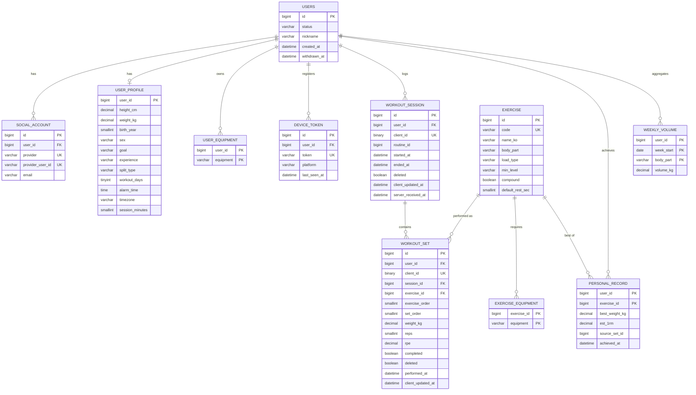
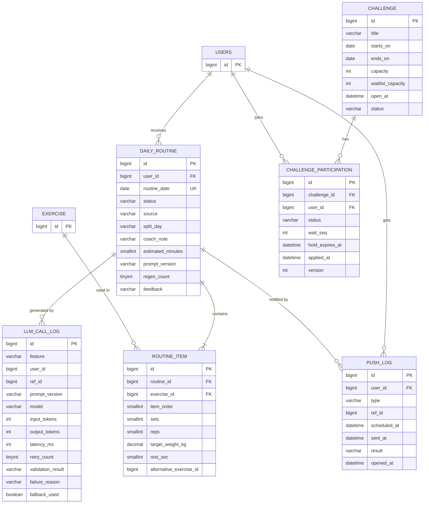

# DB 스키마 설계 (1차 오픈)

나만의 트레이너 쌤 1차 오픈 범위와, 1차 중 병행하는 챌린지 동시성 실험에 필요한 테이블.

- 작성일: 2026-10-28
- DB: MySQL 8 (InnoDB, utf8mb4)
- 관리: 테이블 생성·변경은 Flyway 마이그레이션, JPA는 `ddl-auto=validate`
- 관련 문서: prd.md, trainer-ssaem-spec.md

---

## 1. 설계 원칙

| 항목 | 규칙 | 이유 |
| --- | --- | --- |
| 기본 키 | BIGINT AUTO_INCREMENT | 단순하고 인덱스가 작음 |
| 오프라인 기록 식별자 | 앱이 만든 UUID를 `client_id BINARY(16)`로 저장 | 재전송돼도 한 번만 저장(멱등성). 문자열보다 인덱스가 작음 |
| 시각 | `DATETIME(6)`, UTC로 저장 | 서버·기기 시간대 차이를 없앰 |
| 사용자 기준 날짜 | `DATE` 컬럼으로 따로 저장 (routine_date, week_start) | "오늘"은 사용자 시간대 기준이라 시각만으로는 판단 어려움 |
| 상태값 | `VARCHAR` + 애플리케이션 enum | MySQL ENUM은 값 추가 시 테이블 변경 필요 |
| 무게 | `DECIMAL(6,2)` | 82.5kg 같은 값을 오차 없이 저장 |
| 외래 키 | 같은 모듈 안에서만 건다 | 모듈 간 참조는 ID + 인덱스만. 나중에 모듈 분리 시 걸림돌 제거 |
| 삭제 | 운동 기록은 `deleted` 표시(tombstone) | 늦게 도착한 수정이 삭제된 기록을 되살리지 않게 |

### 모듈별 테이블

| 모듈 | 테이블 |
| --- | --- |
| user | users, social_account, user_profile, user_equipment, device_token |
| workout | exercise, exercise_equipment, workout_session, workout_set, personal_record, weekly_volume |
| routine | daily_routine, routine_item |
| notification | push_log |
| llm | llm_call_log |
| challenge | challenge, challenge_participation |
| 공통 | shedlock, event_log |

> exercise(종목 사전)는 workout 모듈이 소유하고, routine 모듈은 공개 인터페이스로 조회한다.

---

## 2. ERD

### 2.1 사용자와 운동 기록



### 2.2 루틴, 알림, LLM, 챌린지



> ERD의 FK 표시는 논리적 관계다. 실제 외래 키 제약은 같은 모듈 안에서만 건다 (아래 테이블별 정의 참고).

---

## 3. 테이블별 정의

공통으로 별도 언급이 없으면 모든 테이블에 `created_at DATETIME(6) NOT NULL`, `updated_at DATETIME(6) NOT NULL`이 있다.

### 3.1 user 모듈

#### users

| 컬럼 | 타입 | 제약 | 설명 |
| --- | --- | --- | --- |
| id | BIGINT | PK, AUTO_INCREMENT | |
| status | VARCHAR(20) | NOT NULL | ONBOARDING, ACTIVE, WITHDRAWN |
| nickname | VARCHAR(30) | NOT NULL | |
| withdrawn_at | DATETIME(6) | NULL | 탈퇴 시각 |

- 인덱스: 없음 (PK 조회 위주)

#### social_account

| 컬럼 | 타입 | 제약 | 설명 |
| --- | --- | --- | --- |
| id | BIGINT | PK | |
| user_id | BIGINT | NOT NULL, FK → users.id | |
| provider | VARCHAR(20) | NOT NULL | KAKAO, GOOGLE, APPLE |
| provider_user_id | VARCHAR(100) | NOT NULL | 소셜 서비스의 사용자 식별자 |
| email | VARCHAR(255) | NULL | 제공되지 않을 수 있음 |

- 유니크: `(provider, provider_user_id)` — 같은 소셜 계정으로 중복 가입 방지
- 인덱스: `(user_id)`
- 한 사용자가 여러 소셜 계정을 연결할 수 있는 구조. 연결 정책은 열린 질문

#### user_profile

사용자와 1:1. PK가 곧 user_id.

| 컬럼 | 타입 | 제약 | 설명 |
| --- | --- | --- | --- |
| user_id | BIGINT | PK, FK → users.id | |
| height_cm | DECIMAL(5,1) | NOT NULL | |
| weight_kg | DECIMAL(5,1) | NOT NULL | 최신 체중. 추이는 2차 체중 기록 테이블 |
| birth_year | SMALLINT | NOT NULL | 나이는 매년 바뀌므로 출생 연도 저장 |
| sex | VARCHAR(10) | NOT NULL | 기초대사량 공식(Mifflin-St Jeor)에 필요 |
| goal | VARCHAR(20) | NOT NULL | CUT, BULK, MAINTAIN |
| experience | VARCHAR(20) | NOT NULL | BEGINNER, INTERMEDIATE, ADVANCED |
| split_type | VARCHAR(20) | NOT NULL | FULL_BODY, TWO_SPLIT, THREE_SPLIT |
| workout_days | TINYINT | NOT NULL | 요일 비트마스크 (월=1, 화=2, 수=4, 목=8, 금=16, 토=32, 일=64) |
| alarm_time | TIME | NOT NULL | 사용자 시간대 기준 알림 시각 |
| timezone | VARCHAR(40) | NOT NULL | 기본 Asia/Seoul |
| session_minutes | SMALLINT | NOT NULL | 선호 운동 시간 (루틴 시간 검증용) |

- 인덱스: `(alarm_time)` — 1분 스케줄러가 "알림 시각이 30분 안에 다가온 사용자"를 조회
- 오늘이 운동일인지: `workout_days & (1 << 요일번호) > 0`

#### user_equipment

사용자가 쓸 수 있는 장비. 후보 종목 필터의 입력.

| 컬럼 | 타입 | 제약 | 설명 |
| --- | --- | --- | --- |
| user_id | BIGINT | PK, FK → users.id | |
| equipment | VARCHAR(30) | PK | BARBELL, DUMBBELL, MACHINE, CABLE, BENCH, PULLUP_BAR, KETTLEBELL, BODYWEIGHT |

#### device_token

FCM 푸시 토큰. 한 사용자가 여러 기기를 쓸 수 있다.

| 컬럼 | 타입 | 제약 | 설명 |
| --- | --- | --- | --- |
| id | BIGINT | PK | |
| user_id | BIGINT | NOT NULL, FK → users.id | |
| token | VARCHAR(255) | NOT NULL | FCM 토큰 |
| platform | VARCHAR(10) | NOT NULL | ANDROID, IOS |
| last_seen_at | DATETIME(6) | NOT NULL | 앱 실행 시 갱신 |

- 유니크: `(token)`
- 인덱스: `(user_id)`
- FCM이 만료 응답을 주면 행을 삭제

### 3.2 workout 모듈

#### exercise (종목 사전)

| 컬럼 | 타입 | 제약 | 설명 |
| --- | --- | --- | --- |
| id | BIGINT | PK | |
| code | VARCHAR(50) | NOT NULL | 예: BACK_SQUAT. LLM 출력과 평가에서 사용 |
| name_ko | VARCHAR(50) | NOT NULL | 백 스쿼트 |
| body_part | VARCHAR(20) | NOT NULL | CHEST, BACK, SHOULDER, LEGS, ARMS, CORE |
| load_type | VARCHAR(20) | NOT NULL | BARBELL, DUMBBELL, MACHINE, BODYWEIGHT (과부하 규칙 증가폭 결정) |
| min_level | VARCHAR(20) | NOT NULL | 권장 최소 경력 |
| compound | BOOLEAN | NOT NULL | 다관절 운동 여부 (순서 배치용) |
| default_rest_sec | SMALLINT | NOT NULL | 기본 휴식 시간 |
| active | BOOLEAN | NOT NULL | 비활성 종목은 후보에서 제외 |

- 유니크: `(code)`
- 인덱스: `(body_part, active)`
- 초기 데이터: 50~80개, Flyway 마이그레이션으로 삽입

#### exercise_equipment

| 컬럼 | 타입 | 제약 | 설명 |
| --- | --- | --- | --- |
| exercise_id | BIGINT | PK, FK → exercise.id | |
| equipment | VARCHAR(30) | PK | 필요한 장비 |

**후보 종목 필터 쿼리 (예시)**

필요한 장비를 사용자가 모두 가진 종목만 고른다.

```sql
SELECT e.*
FROM exercise e
WHERE e.active = TRUE
  AND e.body_part IN (:bodyParts)
  AND NOT EXISTS (
    SELECT 1
    FROM exercise_equipment ee
    WHERE ee.exercise_id = e.id
      AND ee.equipment NOT IN (
        SELECT ue.equipment FROM user_equipment ue WHERE ue.user_id = :userId
      )
  );
```

#### workout_session

| 컬럼 | 타입 | 제약 | 설명 |
| --- | --- | --- | --- |
| id | BIGINT | PK | |
| user_id | BIGINT | NOT NULL | 모듈 간 참조, FK 없음 |
| client_id | BINARY(16) | NOT NULL | 앱이 만든 UUID |
| routine_id | BIGINT | NULL | 어떤 루틴으로 한 운동인지, FK 없음 |
| started_at | DATETIME(6) | NOT NULL | |
| ended_at | DATETIME(6) | NULL | 종료 시 세션 종료 이벤트 발행 |
| condition_note | VARCHAR(200) | NULL | 컨디션 메모 |
| deleted | BOOLEAN | NOT NULL | tombstone |
| client_updated_at | DATETIME(6) | NOT NULL | 충돌 판정 기준 (last-write-wins) |
| server_received_at | DATETIME(6) | NOT NULL | 기기 시계 어긋남 확인용 |

- 유니크: `(user_id, client_id)` — 멱등성 핵심
- 인덱스: `(user_id, started_at)`

#### workout_set

| 컬럼 | 타입 | 제약 | 설명 |
| --- | --- | --- | --- |
| id | BIGINT | PK | |
| user_id | BIGINT | NOT NULL | 정규화상 불필요하지만 의도적으로 둠 (아래 참고) |
| client_id | BINARY(16) | NOT NULL | |
| session_id | BIGINT | NOT NULL, FK → workout_session.id | |
| exercise_id | BIGINT | NOT NULL, FK → exercise.id | |
| exercise_order | SMALLINT | NOT NULL | 세션 안 종목 순서 |
| set_order | SMALLINT | NOT NULL | 종목 안 세트 순서 |
| weight_kg | DECIMAL(6,2) | NOT NULL | 맨몸은 0 |
| reps | SMALLINT | NOT NULL | |
| rpe | DECIMAL(3,1) | NULL | 체감 강도 |
| completed | BOOLEAN | NOT NULL | |
| deleted | BOOLEAN | NOT NULL | tombstone |
| performed_at | DATETIME(6) | NOT NULL | 세트 수행 시각 |
| client_updated_at | DATETIME(6) | NOT NULL | |

- 유니크: `(user_id, client_id)`
- 인덱스: `(session_id)`, `(user_id, exercise_id, performed_at)`
- **user_id, performed_at를 둔 이유:** 멱등성 유니크 범위를 사용자 단위로 잡고, "이 종목의 최근 2주 기록"(과부하 규칙, LLM 맥락)을 세션 조인 없이 인덱스 하나로 조회하기 위해

#### personal_record

세션 종료 이벤트로 갱신하는 사전 집계.

| 컬럼 | 타입 | 제약 | 설명 |
| --- | --- | --- | --- |
| user_id | BIGINT | PK | |
| exercise_id | BIGINT | PK | |
| best_weight_kg | DECIMAL(6,2) | NOT NULL | 최고 무게 |
| est_1rm | DECIMAL(6,2) | NOT NULL | 추정 1RM (Epley 공식 등) |
| source_set_id | BIGINT | NOT NULL | 기록을 만든 세트 |
| achieved_at | DATETIME(6) | NOT NULL | |

#### weekly_volume

세션 종료 이벤트로 갱신하는 사전 집계. 주간 리포트·랭킹 조회용.

| 컬럼 | 타입 | 제약 | 설명 |
| --- | --- | --- | --- |
| user_id | BIGINT | PK | |
| week_start | DATE | PK | 사용자 시간대 기준 주 시작일(월요일) |
| body_part | VARCHAR(20) | PK | |
| volume_kg | DECIMAL(12,2) | NOT NULL | 무게 × 반복 수 합계 |

- 집계 누락 시 이벤트 재처리 또는 원본 세트로 재계산해 복구

### 3.3 routine 모듈

#### daily_routine

| 컬럼 | 타입 | 제약 | 설명 |
| --- | --- | --- | --- |
| id | BIGINT | PK | |
| user_id | BIGINT | NOT NULL | FK 없음 |
| routine_date | DATE | NOT NULL | 사용자 시간대 기준 날짜 |
| status | VARCHAR(20) | NOT NULL | PENDING, GENERATED, FALLBACK, FAILED, SKIPPED |
| source | VARCHAR(20) | NOT NULL | LLM, FALLBACK, REGENERATED |
| split_day | VARCHAR(20) | NOT NULL | 오늘 분할 부위 (예: LOWER) |
| coach_note | VARCHAR(300) | NULL | LLM 코칭 문구 |
| estimated_minutes | SMALLINT | NULL | |
| prompt_version | VARCHAR(30) | NULL | 예: routine-v3 |
| regen_count | TINYINT | NOT NULL | "다른 루틴" 요청 횟수 (하루 2회 제한) |
| feedback | VARCHAR(10) | NULL | EASY, OK, HARD (운동 후 난이도) |

- 유니크: `(user_id, routine_date)` — 같은 날 루틴 중복 생성을 DB가 차단
- 인덱스: `(routine_date, status)` — 생성 대상·실패 조회
- **feedback을 여기 둔 이유:** prompt_version과 같은 행에 있어 프롬프트 버전별 사용자 반응을 바로 비교 가능. 그래서 명세의 prompt_feedback 테이블은 2차 AI 트레이너 답변용으로 미룸
- "오늘은 쉴래요"는 status = SKIPPED로 기록

#### routine_item

| 컬럼 | 타입 | 제약 | 설명 |
| --- | --- | --- | --- |
| id | BIGINT | PK | |
| routine_id | BIGINT | NOT NULL, FK → daily_routine.id | |
| exercise_id | BIGINT | NOT NULL | FK 없음 (workout 모듈 소유) |
| item_order | SMALLINT | NOT NULL | |
| sets | SMALLINT | NOT NULL | 서버 규칙 계산값 |
| reps | SMALLINT | NOT NULL | 서버 규칙 계산값 |
| target_weight_kg | DECIMAL(6,2) | NOT NULL | 서버 규칙 계산값 |
| rest_sec | SMALLINT | NOT NULL | |
| alternative_exercise_id | BIGINT | NULL | 장비가 없을 때 대체 종목 |

- 인덱스: `(routine_id, item_order)`

### 3.4 notification 모듈

#### push_log

| 컬럼 | 타입 | 제약 | 설명 |
| --- | --- | --- | --- |
| id | BIGINT | PK | |
| user_id | BIGINT | NOT NULL | |
| type | VARCHAR(30) | NOT NULL | DAILY_ROUTINE, CHALLENGE_PROMOTED 등 |
| ref_id | BIGINT | NULL | 대상 루틴·챌린지 id |
| scheduled_at | DATETIME(6) | NOT NULL | 발송 예정 시각 |
| sent_at | DATETIME(6) | NULL | |
| result | VARCHAR(20) | NOT NULL | PENDING, SENT, FAILED, TOKEN_EXPIRED |
| opened_at | DATETIME(6) | NULL | 알림을 눌러 앱을 연 시각 (알림 열람률 지표) |

- 유니크: `(user_id, type, ref_id)` — 같은 루틴에 알림이 두 번 가지 않게
- 인덱스: `(result, scheduled_at)` — 발송 대상 조회

### 3.5 llm 모듈

#### llm_call_log

| 컬럼 | 타입 | 제약 | 설명 |
| --- | --- | --- | --- |
| id | BIGINT | PK | |
| feature | VARCHAR(30) | NOT NULL | ROUTINE, DIET, COACH_CHAT 등 |
| user_id | BIGINT | NULL | 평가 실행은 NULL |
| ref_id | BIGINT | NULL | 결과가 저장된 대상 (daily_routine.id 등) |
| prompt_version | VARCHAR(30) | NOT NULL | |
| model | VARCHAR(60) | NOT NULL | |
| input_tokens | INT | NOT NULL | |
| output_tokens | INT | NOT NULL | |
| latency_ms | INT | NOT NULL | |
| retry_count | TINYINT | NOT NULL | |
| validation_result | VARCHAR(20) | NOT NULL | PASS, SCHEMA_ERROR, RULE_VIOLATION, TIMEOUT |
| failure_reason | VARCHAR(300) | NULL | 검증 실패 상세 |
| fallback_used | BOOLEAN | NOT NULL | 기본 루틴으로 대체됐는지 |

- 인덱스: `(feature, created_at)`, `(prompt_version, created_at)`
- 쓰기 전용 로그라 수정 없음. 행이 많아지면 월 단위 파티셔닝 또는 오래된 행 정리 검토

### 3.6 challenge 모듈 (1차 병행 실험용)

#### challenge

| 컬럼 | 타입 | 제약 | 설명 |
| --- | --- | --- | --- |
| id | BIGINT | PK | |
| title | VARCHAR(100) | NOT NULL | |
| starts_on | DATE | NOT NULL | |
| ends_on | DATE | NOT NULL | |
| capacity | INT | NOT NULL | 정원 |
| waitlist_capacity | INT | NOT NULL | 대기 정원 (정원의 50%) |
| applied_count | INT | NOT NULL | 현재 신청 수 (DB 락 실험용) |
| open_at | DATETIME(6) | NOT NULL | 일반 신청 오픈 시각 |
| status | VARCHAR(20) | NOT NULL | SCHEDULED, OPEN, IN_PROGRESS, FINISHED |
| version | INT | NOT NULL | 낙관적 락 실험용 |

#### challenge_participation

| 컬럼 | 타입 | 제약 | 설명 |
| --- | --- | --- | --- |
| id | BIGINT | PK | |
| challenge_id | BIGINT | NOT NULL, FK → challenge.id | |
| user_id | BIGINT | NOT NULL | |
| status | VARCHAR(20) | NOT NULL | HOLD, APPLIED, WAITING, CANCELED, EXPIRED |
| wait_seq | INT | NULL | 대기 순번 |
| hold_expires_at | DATETIME(6) | NULL | 임시 확보 만료 시각 (10분, 승급자는 30분) |
| applied_at | DATETIME(6) | NULL | 확정 시각 |
| version | INT | NOT NULL | 낙관적 락 |

- 유니크: `(challenge_id, user_id)` — 최후의 중복 신청 안전망. 취소 후 재신청은 새 행이 아니라 상태 변경
- 인덱스: `(challenge_id, status, wait_seq)` — 대기 1순위 조회, `(status, hold_expires_at)` — 만료 처리

**동시성 실험 4가지 방식과 사용 컬럼**

| 방식 | 사용 |
| --- | --- |
| DB 비관적 락 | `SELECT ... FROM challenge WHERE id = ? FOR UPDATE` 후 applied_count 증가 |
| DB 낙관적 락 | challenge.version 비교 후 갱신, 실패 시 재시도 |
| Redis 원자 연산 | Redis Lua 스크립트로 정원·중복 판정, DB는 비동기 반영 |
| 대기열 | Redis Sorted Set 접속 대기열 + 입장 토큰 |

인증·완주·배지·포인트 테이블(challenge_check_in, badge, user_badge, point_ledger)은 3차에 추가.

### 3.7 공통

#### shedlock

ShedLock 라이브러리가 정한 형식을 그대로 사용.

| 컬럼 | 타입 | 제약 |
| --- | --- | --- |
| name | VARCHAR(64) | PK |
| lock_until | TIMESTAMP(3) | NOT NULL |
| locked_at | TIMESTAMP(3) | NOT NULL |
| locked_by | VARCHAR(255) | NOT NULL |

#### event_log

제품 지표용 이벤트 기록.

| 컬럼 | 타입 | 제약 | 설명 |
| --- | --- | --- | --- |
| id | BIGINT | PK | |
| user_id | BIGINT | NULL | |
| name | VARCHAR(50) | NOT NULL | APP_OPEN, PUSH_OPEN, ROUTINE_VIEW, SESSION_COMPLETE 등 |
| properties | JSON | NULL | |
| occurred_at | DATETIME(6) | NOT NULL | |

- 인덱스: `(name, occurred_at)`, `(user_id, occurred_at)`

---

## 4. Redis에 두는 것 (테이블 없음)

| 키 | 용도 | TTL |
| --- | --- | --- |
| `refresh:{userId}:{tokenId}` | 리프레시 토큰 (갱신 시 교체) | 14일 |
| `routine:{userId}:{date}` | 오늘의 루틴 캐시 | 36시간 |
| `challenge:{id}:applied` | 신청자 Set (Redis 방식 실험) | 챌린지 종료까지 |
| `challenge:{id}:waiting` | 대기자 Sorted Set | 챌린지 시작까지 |
| `challenge:{id}:queue` | 접속 대기열 Sorted Set | 오픈 후 정리 |

---

## 5. 2차 이후 추가 예정

| 단계 | 테이블 |
| --- | --- |
| 2차 | daily_meal_plan, meal_item, food_log, food_estimate_cache, weight_log, coach_conversation, coach_message, prompt_feedback |
| 3차 | challenge_check_in, badge, user_badge |
| 확장 | point_ledger, challenge_proof, pose_analysis, proof_report |

---

## 6. 열린 질문

- [ ] 회원 탈퇴 시 운동 기록을 즉시 삭제할지, 일정 기간 보관 후 삭제할지
- [ ] 같은 이메일의 다른 소셜 계정을 자동 연결할지
- [ ] 1차 종목 사전 규모 (50~80개 예상)
- [ ] 추정 1RM 공식 (Epley 또는 Brzycki)
- [ ] llm_call_log, event_log 보관 기간
